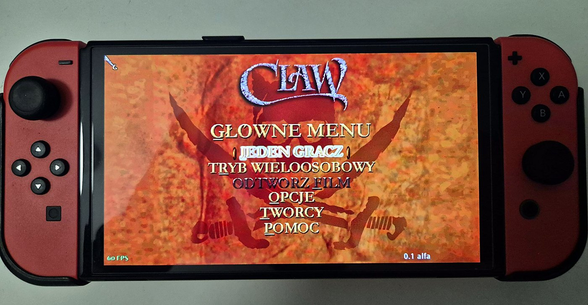
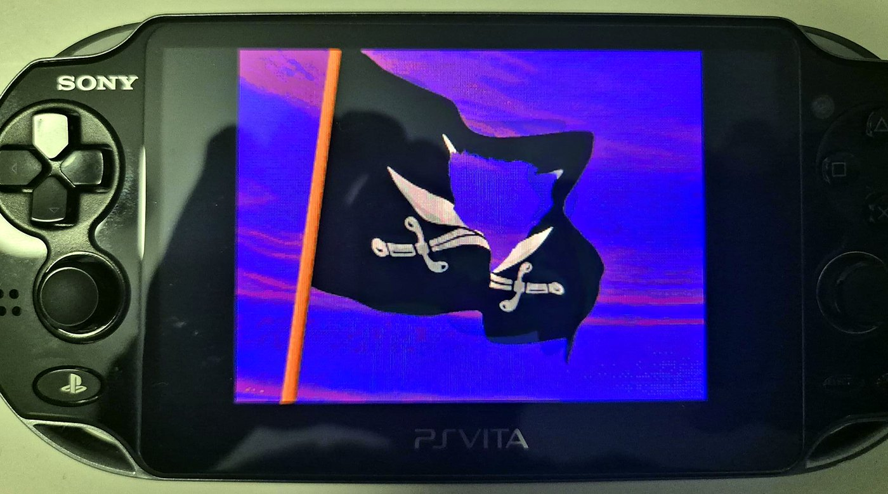
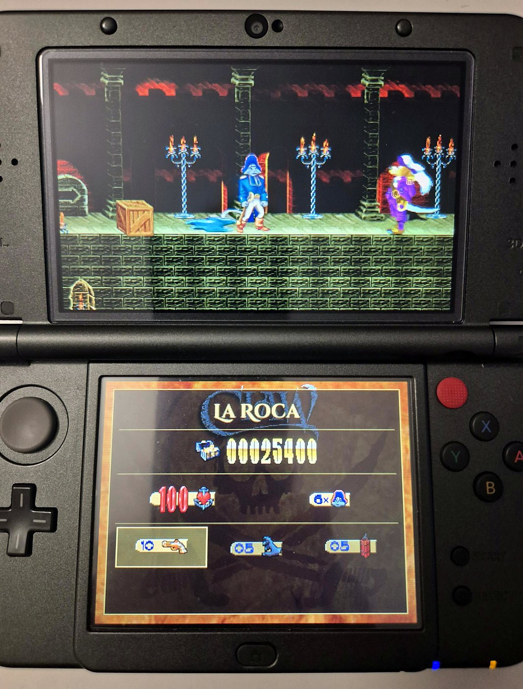
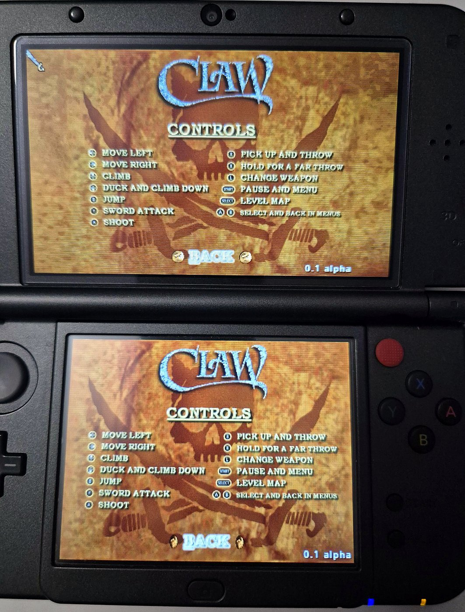

# ReClaw (reclaw-engine)

*English below · [Opis po polsku](#po-polsku)*

**ReClaw** is an unofficial, fan-made engine for the platform game **Claw**
(Monolith Productions, 1997), also known as Captain Claw / Kapitan Pazur.
It runs the original game from your own copy of its data on game
consoles, and adds a few things of its own.

> **ReClaw contains no game data.** You need `CLAW.REZ` (and, for the
> movies, `CLAW.FEC`) from a copy of Claw you own. ReClaw is not affiliated
> with or endorsed by Monolith Productions or Warner Bros.; "Claw" and
> "Captain Claw" are their trademarks.

## Screenshots

Photos of the real consoles, not emulators.

| | |
|---|---|
|  |  |
| **Nintendo Switch OLED** – the main menu of the Polish release, with the FPS counter on | **PS Vita** – the game's movies play too |
|  |  |
| **New Nintendo 3DS** – La Roca above; score, health, lives and weapons on the lower screen | **New Nintendo 3DS** – the controls page, made for the 3DS buttons |

## Why ReClaw

Claw is one of my favourite childhood games – and a devilishly hard one.
I still have a real soft spot for it. I know about OpenClaw and a few web
projects that bring it back, but what I was missing was playing it on the go:
I rarely have time to sit down at a PC these days, and the 3DS, the Vita and
the Switch are consoles I am especially fond of. So I decided to do something
about it.

The project was renamed from OpenClaw to ReClaw because searching for
"OpenClaw" now mostly turns up an open-source AI assistant of the same name.
That was the main reason; on top of that, I plan to grow the project with new
features over time.

## Platforms

| Platform | Package | ReClaw folder (CLAW.REZ goes to its `data/`) |
|---|---|---|
| Nintendo Switch | `reclaw.nro` | `sd:/switch/reclaw/` |
| PS Vita | `reclaw.vpk` | `ux0:data/reclaw/` |
| Nintendo 3DS | `reclaw.cia` / `reclaw.3dsx` | `sdmc:/3ds/reclaw/` |
| PS3 | `reclaw.pkg` / `reclaw_hen.pkg` | `/dev_hdd0/game/RCLW00001/USRDIR/` |

All four versions were tested on real hardware:

- **New Nintendo 3DS** – Luma3DS, higher clock speed and L2 cache on
- **PlayStation 3 Slim** – Evilnat CFW 4.93, stock clock
- **Nintendo Switch OLED** – firmware 23.0.1, Atmosphère 1.12.1, stock clock
- **PS Vita** – firmware 3.65, HENkaku Ensō, stock clock

All of them run at a full 60 fps – even the New 3DS with the 3D mode on.
On the New 3DS the second screen works too. The game has not been tested on the
original (Old) 3DS / 2DS, so how well it runs there is unknown.

The source tree still holds code for other platforms inherited from earlier
work; it is untested and not released.

Details (controls, second screens, building): [docs/PORTY.md](docs/PORTY.md) (Polish).

### Known issues

ReClaw is an alpha. Not working yet or incomplete:

- **Level 14** – missing (it does not work)
- **Level 13** – the chameleons are missing
- **Claw's movement** – no acceleration (Claw does not speed up gradually as
  in the original)
- **Objects** – the logic of some objects differs a little from the original
- **Bosses** – Gabriel (8) and Marrow (10) work; Le Rauxe (2), Katherine (4)
  and Wolvington (6) only have generic behaviour; Aquatis (12) and Red Tail
  (13) are simplified
- **Powder kegs** – the flight physics of a thrown keg is not right yet
  (path, strength, bounces); the keg-carrying animations are placeholders

Please report bugs with `reclaw.log` (or `reclaw_previous.log` after a crash)
from the `save/` folder.

### The ReClaw folder

```
reclaw/
├── reclaw.nro          (Switch)
├── data/
│   ├── pl/             CLAW.REZ, CLAW.FEC of the Polish release (or an unpacked Assets)
│   └── en/             CLAW.REZ, CLAW.FEC of the English release
├── lang/
│   ├── pl/
│   │   └── menu/strings.txt      texts of the port's menus and screens
│   └── en/   (the same)
└── save/               config.xml, SAVES.XML, port_settings.txt, reclaw.log,
                        reclaw_previous.log (the last session's log)
```

The game creates these folders on its first start.

Each sub-folder of `data/` with CLAW.REZ is one language (the folder name is
the language code, `de/`, `fr/`... work too). With one folder the game uses
that language and Options → Language is greyed out. With several: English
(`en`) on the first start, then the language chosen in **Options →
Language** – saved in `save/config.xml`, applied when the game is started
again. CLAW.REZ put straight into `data/` also works (as the only language).


## What ReClaw adds

- **Four consoles** – Nintendo Switch, PS Vita, Nintendo 3DS and PS3, all
  with GPU rendering and a full 60 fps
- **Widescreen** – full 16:9 support, or the classic 4:3 picture
- **Polish and English** – both releases of the game are supported and the
  language can be switched in the menu; ReClaw's own screens are translated too
- **Graphics filters** – smoothing and a CRT effect, each switchable on and off
- **Zoom out** – the view can be widened in four steps (Normal, Wide, Wider,
  Widest) to see more of the level
- **FPS counter** – can be switched on in the graphics options
- **New 3DS** – stereoscopic 3D, and a second screen with the menu map and the
  player's status
- **Controls page** – a controls screen made for each console's buttons
- **Touch screen** – on the Switch and the PS Vita the menus work by touch
- **Level map** – Claw has a map in the game, so now you can look at it: press
  Select (Minus on the Switch; on the 3DS it shows on the lower screen). It
  shows the level's rooms and the treasures, but not the enemies

## Based on

ReClaw would not exist without these projects (all GPL-3.0):

- [OpenClaw](https://github.com/pjasicek/OpenClaw) by Petr Jašíček, Pavel Löbl and contributors – the engine
- [claw-web](https://github.com/arthurboss/claw-web) by Arthur Boss – this repository is a fork of it
  (its original README: [docs/README-claw-web.md](docs/README-claw-web.md))
- [ClawSwitch](https://github.com/djmuted/ClawSwitch) by djmuted – the first Switch port

ReClaw: Herbaciarz, made with the help of Claude (Anthropic).

## Building

Each console has its folder in `platform/` (`switch`, `vita`, `3ds`, `ps3`)
and is built with its homebrew SDK (devkitPro, VitaSDK, PSL1GHT) – see
[docs/PORTY.md](docs/PORTY.md).

## License

GPL-3.0, like the projects it is based on – see [LICENSE.txt](LICENSE.txt).
Third-party parts keep their own licenses (Box2D, TinyXML, TinySoundFont,
libsmacker, SDL2, fonts – see `ThirdParty/` and the font folders).

---

## Po polsku

**ReClaw** to nieoficjalny, fanowski silnik platformówki **Claw**
(Monolith Productions, 1997), znanej też jako Captain Claw / Kapitan Pazur.
Uruchamia oryginalną grę z Twojej własnej kopii jej danych na konsolach
i dodaje kilka rzeczy od siebie.

> **ReClaw nie zawiera danych gry.** Potrzebujesz pliku `CLAW.REZ` (a do
> filmów `CLAW.FEC`) z posiadanej kopii Clawa. ReClaw nie jest powiązany
> z Monolith Productions ani Warner Bros. ani przez nie wspierany; „Claw”
> i „Captain Claw” to ich znaki towarowe.

### Zrzuty ekranu

Zdjęcia prawdziwych konsol, nie emulatorów.

| | |
|---|---|
|  |  |
| **Nintendo Switch OLED** – menu główne polskiego wydania z włączonym licznikiem FPS | **PS Vita** – filmy z gry też działają |
|  |  |
| **New Nintendo 3DS** – La Roca na górze; wynik, życie, życia i broń na dolnym ekranie | **New Nintendo 3DS** – strona sterowania dopasowana do przycisków 3DS |

### Dlaczego ReClaw

Claw to jedna z moich ulubionych gier z dzieciństwa – i przy tym diabelnie
trudna. Do dziś mam do niej ogromny sentyment. Wiem, że powstał projekt
OpenClaw i kilka projektów webowych, ale brakowało mi grania przenośnie:
przez brak czasu rzadko siadam przy komputerze, a 3DS-a, Vitę i Switcha
szczególnie lubię. Postanowiłem więc coś z tym zrobić.

Projekt przemianowałem z OpenClawa na ReClawa, bo po wpisaniu „OpenClaw”
w Google od razu wyskakuje OpenClaw – asystent AI o otwartym kodzie. To był
główny powód zmiany nazwy; poza tym z czasem planuję poszerzyć projekt
o nowe funkcje.

### Platformy

| Platforma | Paczka | Folder ReClaw (CLAW.REZ trafia do jego `data/`) |
|---|---|---|
| Nintendo Switch | `reclaw.nro` | `sd:/switch/reclaw/` |
| PS Vita | `reclaw.vpk` | `ux0:data/reclaw/` |
| Nintendo 3DS | `reclaw.cia` / `reclaw.3dsx` | `sdmc:/3ds/reclaw/` |
| PS3 | `reclaw.pkg` / `reclaw_hen.pkg` | `/dev_hdd0/game/RCLW00001/USRDIR/` |

Wszystkie cztery wersje przetestowałem na prawdziwym sprzęcie:

- **New Nintendo 3DS** – Luma3DS, włączone wyższe taktowanie i pamięć L2
- **PlayStation 3 Slim** – Evilnat CFW 4.93, fabryczne taktowanie
- **Nintendo Switch OLED** – firmware 23.0.1, Atmosphère 1.12.1, fabryczne taktowanie
- **PS Vita** – firmware 3.65, HENkaku Ensō, fabryczne taktowanie

Wszystkie działają w pełnych 60 klatkach na sekundę – nawet New 3DS
z włączonym trybem 3D. Na New 3DS działa też drugi ekran. Na starym 3DS / 2DS (Old 3DS)
gra nie była testowana, więc nie wiadomo, jak wydajnie będzie tam działać.

W kodzie zostały jeszcze inne platformy z wcześniejszych prac – nie są
przetestowane ani wydawane.

Szczegóły (sterowanie, drugie ekrany, budowanie): [docs/PORTY.md](docs/PORTY.md).

### Znane problemy

ReClaw to wersja alfa. Jeszcze nie działa albo jest niekompletne:

- **Poziom 14** – brakuje go (nie działa)
- **Poziom 13** – brakuje kameleonów
- **Ruch Kapitana Pazura** – brak fizyki rozpędzania (Pazur nie nabiera
  prędkości stopniowo jak w oryginale)
- **Obiekty** – logika niektórych obiektów trochę różni się od oryginału
- **Bossowie** – Gabriel (8) i Marrow (10) działają; Le Rauxe (2), Katherine
  (4) i Wolvington (6) mają tylko ogólne zachowanie; Aquatis (12) i Red Tail
  (13) są uproszczeni
- **Beczki z prochem** – fizyka lotu rzuconej beczki nie jest jeszcze
  poprawna (tor, siła, odbicia); animacje noszenia beczki są tymczasowe

Błędy najlepiej zgłaszać z plikiem `reclaw.log` (albo `reclaw_previous.log`
po wywałce) z folderu `save/`.

### Folder ReClaw

```
reclaw/
├── reclaw.nro          (Switch)
├── data/
│   ├── pl/             CLAW.REZ, CLAW.FEC z polskiego wydania (albo rozpakowane Assets)
│   └── en/             CLAW.REZ, CLAW.FEC z angielskiego wydania
├── lang/
│   ├── pl/
│   │   └── menu/strings.txt      teksty menu i ekranów portu
│   └── en/   (to samo)
└── save/               config.xml, SAVES.XML, port_settings.txt, reclaw.log,
                        reclaw_previous.log (log poprzedniej sesji)
```

Gra sama tworzy te foldery przy pierwszym uruchomieniu.

Każdy podfolder `data/` z plikiem CLAW.REZ to jeden język (nazwa folderu to
kod języka, działają też `de/`, `fr/`...). Przy jednym folderze gra używa
tego języka, a Opcje → Język są wyszarzone. Przy kilku: przy pierwszym
uruchomieniu angielski (`en`), potem język wybrany w **Opcje → Język** –
zapisany w `save/config.xml`, działa od następnego uruchomienia gry.
CLAW.REZ wrzucony prosto do `data/` też działa (jako jedyny język).

### Co dodaje ReClaw

- **Cztery konsole** – Nintendo Switch, PS Vita, Nintendo 3DS i PS3,
  wszystkie z rysowaniem przez GPU i w pełnych 60 klatkach na sekundę
- **Panorama** – pełna obsługa 16:9 albo klasyczny obraz 4:3
- **Polski i angielski** – obsługa obu wydań gry, język zmienia się w menu;
  własne ekrany ReClaw też są przetłumaczone
- **Filtry graficzne** – wygładzanie i efekt CRT, każdy do włączenia
  i wyłączenia
- **Oddalanie widoku** – widok można poszerzyć w czterech krokach (normalny,
  szeroki, szerszy, najszerszy), żeby widzieć więcej poziomu
- **Licznik FPS** – do włączenia w opcjach grafiki
- **New 3DS** – tryb 3D i drugi ekran z mapą z menu i stanem gracza
- **Strona sterowania** – ekran sterowania dopasowany do przycisków każdej
  konsoli
- **Ekran dotykowy** – na Switchu i PS Vicie menu obsługuje się dotykiem
- **Mapa poziomu** – Pazur ma przecież mapę, więc teraz można do niej
  zajrzeć: przycisk Select (na Switchu Minus; na 3DS mapa jest na dolnym
  ekranie). Pokazuje pomieszczenia poziomu i skarby, bez przeciwników

### Na podstawie

ReClaw nie powstałby bez tych projektów (wszystkie na GPL-3.0):

- [OpenClaw](https://github.com/pjasicek/OpenClaw) – Petr Jašíček, Pavel Löbl i inni – silnik
- [claw-web](https://github.com/arthurboss/claw-web) – Arthur Boss – to repozytorium jest jego forkiem
- [ClawSwitch](https://github.com/djmuted/ClawSwitch) – djmuted – pierwszy port na Switcha

ReClaw: Herbaciarz, z pomocą Claude (Anthropic).

### Budowanie

Każda konsola ma swój folder w `platform/` (`switch`, `vita`, `3ds`, `ps3`)
i buduje się jej homebrewowym SDK (devkitPro, VitaSDK, PSL1GHT) – zobacz
[docs/PORTY.md](docs/PORTY.md).

### Licencja

GPL-3.0, tak jak projekty, na których się opiera – zobacz [LICENSE.txt](LICENSE.txt).
Części zewnętrzne mają własne licencje (Box2D, TinyXML, TinySoundFont,
libsmacker, SDL2, czcionki – zobacz `ThirdParty/` i foldery czcionek).
